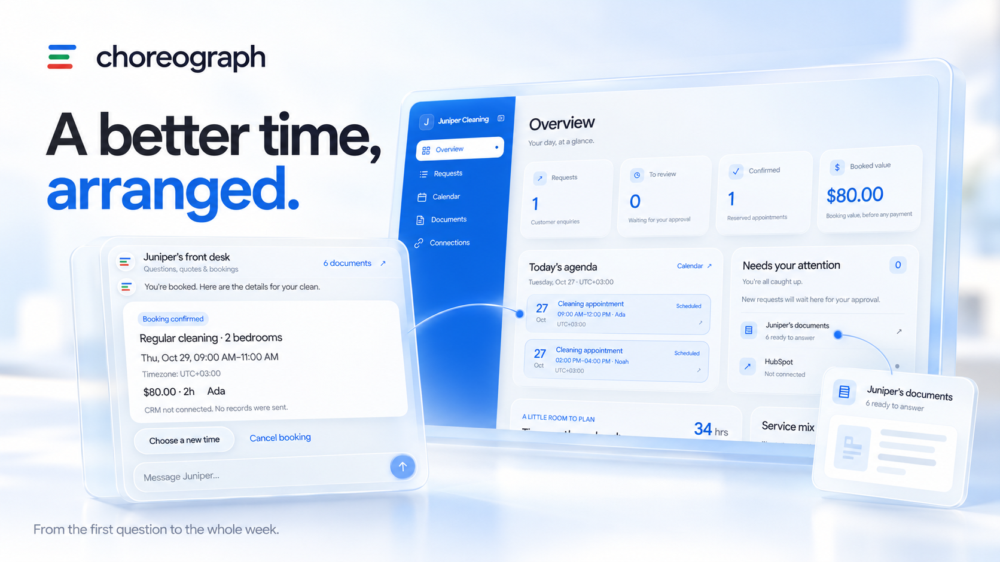

# Choreograph



A portfolio demo of an AI front desk for service businesses. Explore **Juniper Cleaning**, a fictional home-cleaning company, through document-backed answers, exact quotes, reviewed bookings and a shared business calendar.

**[Try the live demo](https://choreograph-frontend-ue3m7uxqdq-ew.a.run.app)** · [Architecture](docs/CHOREOGRAPH.md) · [Security review](docs/security/SECURITY_REVIEW.md)

## Explore the demo

1. Meet Juniper and inspect its six preloaded service and policy guides.
2. Continue without HubSpot, or choose the optional visitor-owned HubSpot connection.
3. Follow the tour, ask a guide question or describe a cleaning job. Open the cited PDF or FAQ to inspect the supporting passage.
4. Review the quote, choose an available appointment and explicitly confirm the booking.
5. Switch to Business view to inspect the same records, calendar and documents. Try rescheduling or cancellation, refresh to restore the workspace, or reset to start again.

No signup is required. Company documents, staff, appointments and exported demo records are fictional; the app does not take payments or arrange real cleaning services. Continuing without HubSpot sends no records to a CRM.

## What it demonstrates

- **Document-grounded AI:** OpenAI and LlamaIndex retrieve actual authorized guide passages, with citations and highlighted original-document previews.
- **Deterministic scheduling:** shared backend commands own prices, duration, staff eligibility, availability, booking revisions and explicit approval. Model text cannot reserve an appointment.
- **Connected customer and business views:** chat, quotes, booking management, calendars and overview charts use the same saved records and visitor-local scheduling timezone.
- **Private persistence:** scoped guest workspaces survive refresh. Encrypted server-side state holds bookings, consent, tokens and delivery work; conditional writes protect concurrent updates.
- **Optional CRM integration:** visitor-owned HubSpot OAuth, consented synthetic exports, destination-bound outbox delivery, retries and cleanup. CRM stays disconnected on the skipped path.

## Architecture

| Component | Responsibility |
| --- | --- |
| Next.js, React and TypeScript | Landing page, conversational workspace, Business view and a narrow server-side API bridge. |
| Python and FastAPI | Session authorization, catalogue rules, quotes, availability, booking lifecycle and integration commands. |
| LlamaIndex and OpenAI | Bounded retrieval, request interpretation and source-backed guidance. |
| Encrypted private GCS objects | Hosted authoritative state and prepared canonical source vectors. Local development uses encrypted atomic files. |
| Cloud Run and Cloud Scheduler | Public frontend, IAM-private API and worker, and one authenticated minute Scheduler job for bounded delivery and maintenance. |

The deployed configuration uses `DATABASE_ENABLED=false`, `FAKE_MODE=false` and `PAID_DEMO_ENABLED=true`. It has no hosted database, Cloud Tasks queue or always-running worker. PostgreSQL/pgvector remains an optional `DATABASE_ENABLED=true` implementation.

## Run locally

Use Node **24.22.1 or newer within 24.x**, Python **3.11** and npm. From the repository root on Windows:

```powershell
python -m venv .venv
.venv/Scripts/python.exe -m pip install -r apps/backend/requirements.lock.txt
.venv/Scripts/python.exe scripts/setup.py
npm ci
npm run dev
```

On macOS/Linux, use `.venv/bin/python` in place of `.venv/Scripts/python.exe`.

Open [the local app](http://127.0.0.1:45860). Use `npm run status` to inspect the owned services and `npm run stop` to stop them while preserving local state.

Setup creates ignored `apps/backend/.env.local` and `apps/frontend/.env.local` files. New setups default to fake AI and encrypted local files, so no provider account or database is needed. Existing configuration is preserved. Keep env assignments unquoted and credentials server-side; see [release operations and provider setup](infra/README.md) for real AI, Turnstile and HubSpot configuration.

## Verification and current scope

The hosted demo was deployed on **26 October 2026**. Actual acceptance covered human verification, a sourced answer and original PDF preview, a USD80 two-bedroom quote, explicit booking, refresh persistence, reset and authenticated Scheduler delivery. [Deployment evidence](docs/tickets/SBS-041-hosted-provider-policy.md) records the tested scope and limitations.

A local review on **4 November 2026** passed 394 portable backend tests with SQL connections forbidden (162 SQL cases excluded), 165 Node checks, frontend types, Ruff and dependency compatibility. The Windows launcher check was verified separately with process-inspection access. The current application fingerprint matches the verified Linux release; [release evidence](infra/release-object-evidence.json) records its images and acceptance checks.

The [quality review](docs/tickets/SBS-037-final-quality.md) and [security audit](docs/tickets/SBS-038-final-security.md) are committed. Both identified runtime security findings were resolved, including the [Python runtime fix](docs/tickets/SBS-040-python-security-runtime.md). Detailed findings and dated advisory coverage remain in the [security report](docs/security/SECURITY_REVIEW.md).

Hosted visitor HubSpot OAuth/export/cleanup/uninstall has not been exercised end to end. High-concurrency hosted capacity and hosted GitHub Actions results are not established by these checks. This repository presents a working portfolio demonstration; local, injected and hosted evidence are distinguished in the owning tickets.

## Project references

- [Product and architecture blueprint](docs/CHOREOGRAPH.md)
- [Release operations, configuration and recovery](infra/README.md)
- [Security findings and remedies](docs/security/SECURITY_REVIEW.md)
- [Implementation tickets and historical checkpoints](docs/tickets/README.md)
- [Figma design system](https://www.figma.com/design/NuFBHKBp3L62zya96K7PGQ?node-id=18-153) · [Key screens](https://www.figma.com/design/NuFBHKBp3L62zya96K7PGQ?node-id=15-3) · [Prototype](https://www.figma.com/proto/NuFBHKBp3L62zya96K7PGQ?node-id=17-238&starting-point-node-id=17%3A238&scaling=min-zoom&content-scaling=fixed)

The Figma prototype and [offline HTML overview](docs/CHOREOGRAPH_OVERVIEW.html) are design references. The deployed app includes subsequent iterations; live integration evidence belongs to the implementation and deployment receipts.
